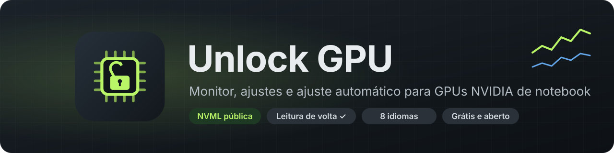
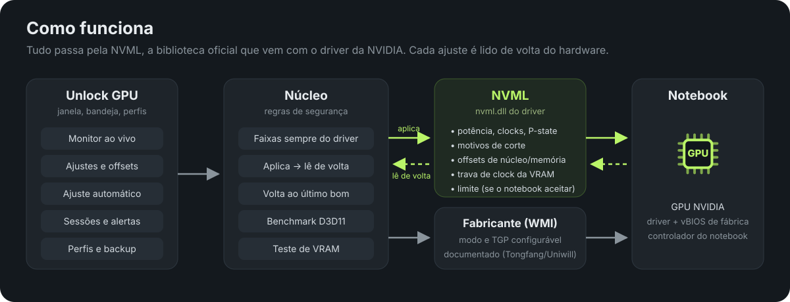
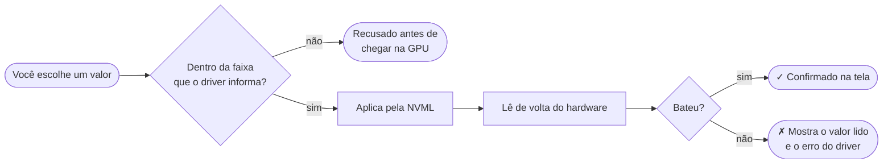
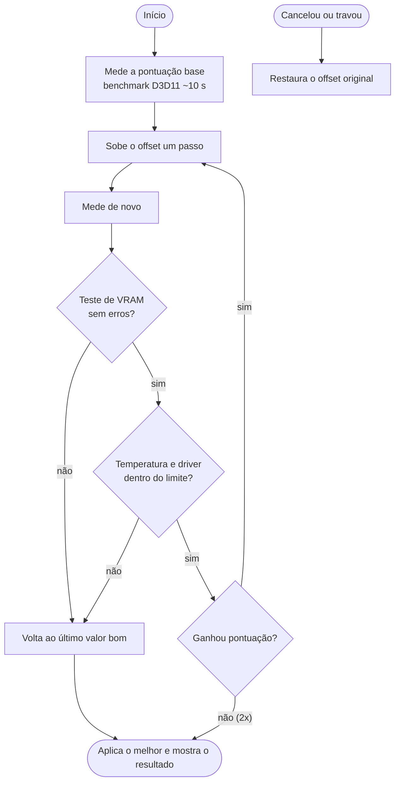

<p align="center">
  
</p>

<p align="center">
  
  
  
  
  
</p>

<p align="center">
  <b>Português</b> · <a href="#english">English</a>
</p>

---

## O que é

O **Unlock GPU** é um app gratuito para Windows que mostra, explica e ajusta a GPU NVIDIA do seu notebook.

Ele responde às perguntas que todo dono de notebook gamer faz e que os painéis dos fabricantes não respondem:

- **Por que a minha GPU não passa de X watts?** O app mostra, em tempo real, o motivo de cada corte de clock: limite de energia, temperatura, freio de energia, limite da placa.
- **Quanto ganho com um overclock?** O ajuste automático sobe o offset aos poucos, mede com um benchmark embutido e para quando o ganho acaba ou aparece instabilidade.
- **O ajuste pegou mesmo?** Tudo o que o app aplica é **lido de volta do hardware** e confirmado na tela: `aplicado +1.500 MHz → lido +1.500 MHz ✓`.

<p align="center">
  
</p>

## Como funciona

<p align="center">
  
</p>

O app conversa com a GPU **só por interfaces públicas**:

| Camada | O que é | Para que o app usa |
|---|---|---|
| **NVML** | `nvml.dll`, a biblioteca oficial que já vem com o driver da NVIDIA | leitura de potência, clocks, temperatura, P-state, motivos de corte; offsets de núcleo e memória; trava de clock da VRAM; limite de potência quando o notebook permite |
| **D3D11** | parte do Windows | benchmark embutido e teste de memória de vídeo |
| **WMI do fabricante** | a interface que o próprio painel do fabricante usa, documentada no kernel Linux | ler (e futuramente ajustar) o modo de desempenho e o TGP configurável em notebooks Tongfang/Uniwill |

Ele **não** modifica a vBIOS, **não** grava valores escondidos no registro do driver e **não** passa do limite que a própria placa informa. As faixas de cada controle vêm sempre do driver, nunca de números fixos no código.

### O ciclo de cada ajuste



### Ajuste automático



Se o teste for cancelado, o driver reiniciar ou algo falhar, o offset original é **sempre** restaurado.

### O que o monitor mostra

| Etiqueta | Significado | Gravidade |
|---|---|---|
| Limitado por potência (SW cap) | a GPU chegou no limite de energia e o driver reduziu o clock | 🟠 tira desempenho |
| Térmico (hardware / software) | corte por temperatura | 🟠 tira desempenho |
| Freio de energia (hardware) | o notebook pediu redução rápida de potência | 🟠 tira desempenho |
| Limite da placa | limite elétrico da própria placa | 🟠 tira desempenho |
| Confiabilidade | corte leve que o driver mantém em repouso | ⚪ normal |
| Ociosa | a GPU está parada | ⚪ normal |
| Nenhum corte | rodando livre | 🟢 |

## Recursos

| Recurso | Status |
|---|---|
| Monitor ao vivo: potência agora e média, núcleo, SM, memória, VRAM em uso, P-state, temperatura, uso | ✅ |
| Motivos de corte traduzidos, como etiquetas coloridas | ✅ |
| Gráfico contínuo (potência, núcleo, memória) | ✅ |
| Offsets de núcleo e memória na faixa do driver, com leitura de volta | ✅ |
| Trava do clock da VRAM por nível (P0 / P2), com detecção pela própria GPU | ✅ |
| Gravação de sessões em CSV, com resumo sob carga | ✅ |
| Limite de potência (nos notebooks que permitem) e teto da placa inteira | ✅ |
| Benchmark D3D11 embutido e teste de VRAM | 🚧 |
| Ajuste automático de offsets | 🚧 |
| Perfis, aplicação ao entrar no Windows, reaplicar após reinício do driver | 🚧 |
| Luz de saúde e alerta de estabilidade | 🚧 |
| Backup e restauração dos valores | 🚧 |
| Ícone na bandeja, janela compacta, cor de destaque | 🚧 |
| Modo e TGP do fabricante (Tongfang/Uniwill), leitura | 🚧 |
| Instalador | 🔜 |

✅ pronto · 🚧 em construção (versão 4, em C#) · 🔜 planejado

## Idiomas

Português · English · Español · Italiano · Français · Deutsch · Русский · 日本語

O idioma segue o do Windows e pode ser trocado no app, sem reiniciar.

## Requisitos

- Windows 10 ou 11, 64 bits
- GPU NVIDIA com driver recente (RTX 30, 40 ou 50; testado numa RTX 5090 Laptop, driver 621)
- Permissão de administrador: a NVIDIA exige isso para aplicar offsets e travas

## Compilar

```powershell
git clone https://github.com/lucasserafin94/Unlock-GPU-.git
cd Unlock-GPU-
dotnet build UnlockGPU.slnx -c Release
```

Precisa do [.NET 10 SDK](https://dotnet.microsoft.com/download). O projeto não usa nenhum pacote externo.

> O código da versão 4 está sendo publicado neste repositório aos poucos; enquanto isso, este comando pode ainda não encontrar a solução.

## Segurança

- Use por sua conta e risco. Overclock pode causar instabilidade, travamentos e falhas na imagem.
- O app nunca passa dos limites que o driver informa e sempre lê de volta o que aplicou.
- Tudo o que ele aplica some quando o driver reinicia; ao reiniciar o Windows, a GPU volta ao padrão, a menos que você ative a aplicação automática de um perfil.
- Se o notebook desligar sozinho ou mostrar erros de hardware, o alerta de estabilidade avisa e você pode voltar tudo ao padrão com um clique.

## Roteiro

1. Versão 4 em C#: tudo da tabela acima.
2. Ajuste do TGP pelo modo do fabricante (Tongfang/Uniwill), depois outras marcas por interfaces documentadas.
3. Comparação de eficiência (FPS por watt) entre perfis.
4. Instalador e atualização automática.

---

<a id="english"></a>

## English

**Unlock GPU** is a free Windows app that shows, explains and tunes the NVIDIA GPU in your laptop.

- **Live monitor** of power (now and average), core, SM and memory clocks, VRAM use, P-state, temperature and utilisation, with every clock-limit reason shown as a readable tag ("power limited", "thermal", "power brake").
- **Core and memory offsets** within the range the driver reports, each one **read back from the hardware** and confirmed.
- **Auto-tune** (in progress): raises the offset step by step, scores each step with a built-in D3D11 benchmark and a VRAM test, and always falls back to the last good value.
- **VRAM clock lock**, session recording, profiles, startup apply, stability alerts and backup.
- **8 languages**: Portuguese, English, Spanish, Italian, French, German, Russian and Japanese.

It only uses public interfaces (NVIDIA NVML, Direct3D 11, the vendor's documented WMI). It does not modify the vBIOS, does not write hidden driver registry values and never goes beyond the limits the card reports.

Use at your own risk: overclocking can cause instability.
